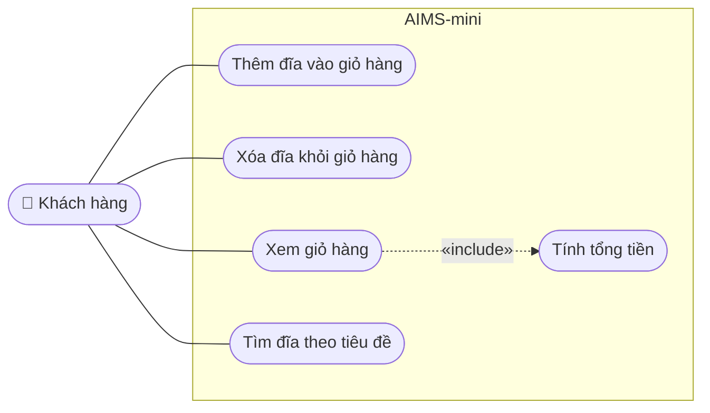

# AIMS-mini – Biểu đồ use case

Hệ thống: ứng dụng dòng lệnh AIMS-mini (giỏ hàng DVD).
Tác nhân: **Khách hàng** (người dùng chương trình).

## Mô tả ngắn

| Use case | Mô tả | Thành phần mã nguồn |
|---|---|---|
| Thêm đĩa vào giỏ hàng | Thêm một DVD; giỏ hàng chứa tối đa `MAX_NUMBERS_ORDERED` đĩa | `Cart.add_dvd()` |
| Xóa đĩa khỏi giỏ hàng | Xóa một DVD đang có trong giỏ | `Cart.remove_dvd()` |
| Xem giỏ hàng | In danh sách đĩa đã đặt và tổng tiền; giỏ trống thì báo "The cart is empty" | `Cart.print_cart()` |
| Tính tổng tiền | Cộng giá các đĩa trong giỏ (được *include* bởi Xem giỏ hàng) | `Cart.total_cost()` |
| Tìm đĩa theo tiêu đề | Trả về các đĩa có tiêu đề chứa từ khóa | `aims.search.search_by_title()` |
